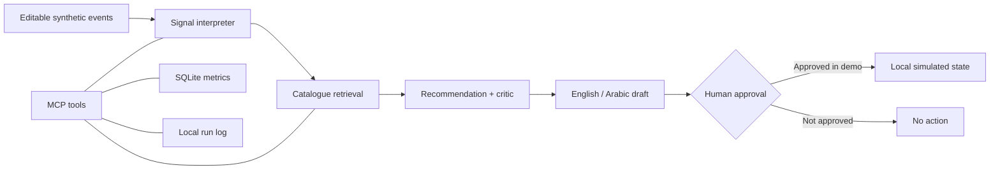

# GiftSense — Agentic Gift Personalisation Demo

**A portfolio demo inspired by a public job description; not affiliated with Printerpix or any other retailer.**

All customer events, catalogue entries, and campaign metrics are synthetic. No real customer data is collected and no messages are sent.

## What it demonstrates

- LangGraph workflow with signal interpretation, catalogue retrieval, recommendation/critique, and message composition.
- Four tool capabilities: synthetic customer-event summarisation, catalogue search, SQLite campaign metrics, and local run logging.
- An MCP server exposing those tools over stdio.
- Market, occasion, and budget filters; catalogue-grounded product claims; human approval state.
- Streamlit interface with editable scenarios and visible execution trace.
- Starter evaluation tests for constraints, no-match handling, and draft-only behaviour.

## Run locally

Requires Python 3.11+.

```bash
python -m venv .venv
# Windows PowerShell: .venv\Scripts\Activate.ps1
# macOS/Linux: source .venv/bin/activate
pip install -r requirements.txt
$env:PYTHONPATH = "src"  # Windows PowerShell
# export PYTHONPATH=src  # macOS/Linux
streamlit run app/streamlit_app.py
```

## Run the MCP server

In a separate terminal with the virtual environment activated:

```bash
# Windows PowerShell
$env:PYTHONPATH = "src"
python -m giftsense.mcp_server

# macOS/Linux
PYTHONPATH=src python -m giftsense.mcp_server
```

The server uses stdio, so it is intended to be launched by an MCP-compatible client. It does not open a public network port.

## Run tests

```bash
pip install pytest
$env:PYTHONPATH = "src"
pytest -q
```

## Architecture



## Current limitations / honest scope

- Retrieval is deterministic metadata filtering plus lightweight text matching, not production vector RAG yet.
- Message composition uses templates; no external LLM call is made.
- The approval checkbox is a UI-only simulation and does not trigger a real campaign.
- The supplied tests are a starter suite, not the final 30–50-case evaluation plan.
- Cost and latency are not yet instrumented as production observability metrics.

## Next build stages

1. Add a 30–50 scenario evaluation harness and export a results table.
2. Add embeddings + Chroma retrieval and compare it with the deterministic baseline.
3. Optionally add an LLM composer behind an environment variable, retaining deterministic fallback and catalogue validation.
4. Instrument latency, token usage, and failure categories.
5. Add Docker packaging, deployment, screenshots, and a 90-second demo script.

## Evaluation dimensions

| Dimension | Expected behaviour |
|---|---|
| Price compliance | Recommended product price is at or below the budget |
| Market compliance | Product is available in the selected synthetic market |
| Occasion relevance | Product metadata includes the selected occasion |
| Grounded claims | Message uses only catalogue-backed facts |
| No-match safety | No product is fabricated if no catalogue item passes filters |
| Approval safety | The app never sends a message externally |

## Privacy and branding

Synthetic data only. No scraping, no customer tracking, no brand assets, and no affiliation implied.
