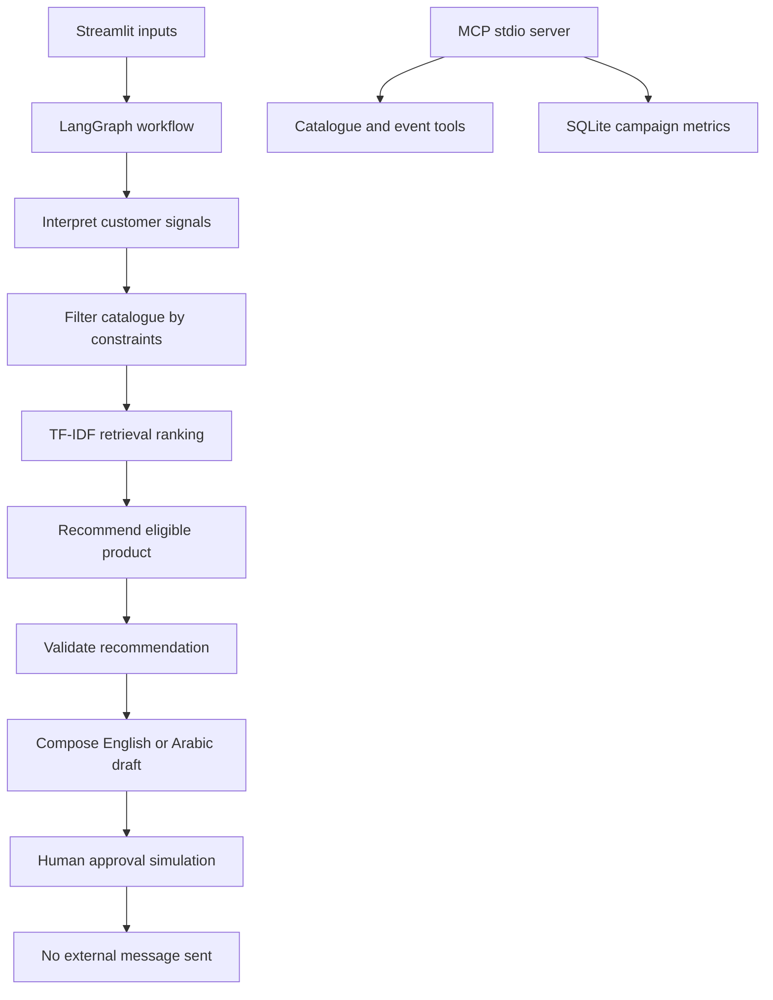

# GiftSense — AI Gift Personalisation Demo

**Live demo:** https://gift-sense-utxmcd2c7s8zctcdxsmhbw.streamlit.app/

**Repository:** https://github.com/MohdSiddiq12/Gift-Sense

GiftSense is a portfolio project demonstrating an agentic workflow for personalised gift recommendations. It combines LangGraph orchestration, catalogue retrieval, recommendation guardrails, multilingual message drafting, and an interactive Streamlit interface.

This is an independent portfolio demo inspired by a public job description. It is not affiliated with Printerpix or any other retailer.

All customer events, products, and campaign metrics are synthetic. The application does not contact customers or send messages.

## Features

- **Agent workflow:** LangGraph pipeline for signal interpretation, retrieval, recommendation, and message composition.
- **Catalogue retrieval:** Hard filters for market, occasion, and budget, followed by TF-IDF text ranking.
- **Recommendation guardrails:** Product recommendations are restricted to eligible catalogue items.
- **Multilingual drafting:** English and Arabic message drafts generated using templates.
- **Human approval:** UI-only approval state; no external action is triggered.
- **MCP tools:** Separate stdio MCP server exposing customer-event summarisation, catalogue search, campaign metrics, and local run logging.
- **Evaluation:** Automated tests for recommendation constraints, no-match behaviour, draft-only safety, and retrieval ranking.
- **Observability:** Execution trace and synthetic campaign metrics displayed in the interface.

## Architecture



## Technology stack

- Python
- Streamlit
- LangGraph
- Model Context Protocol (MCP)
- scikit-learn TF-IDF and cosine similarity
- Pandas
- SQLite
- Pytest

## Run locally

Requires Python 3.12 or a compatible Python version supported by the dependencies.

### 1. Clone the repository

```bash
git clone https://github.com/MohdSiddiq12/Gift-Sense.git
cd Gift-Sense
```

### 2. Create and activate a virtual environment

Windows PowerShell:

```powershell
python -m venv .venv
.\.venv\Scripts\Activate.ps1
```

macOS/Linux:

```bash
python -m venv .venv
source .venv/bin/activate
```

### 3. Install dependencies

```bash
pip install -r requirements.txt
pip install pytest
```

### 4. Start the application

Windows PowerShell:

```powershell
$env:PYTHONPATH = "src"
streamlit run app/streamlit_app.py
```

macOS/Linux:

```bash
PYTHONPATH=src streamlit run app/streamlit_app.py
```

## Run tests

Windows PowerShell:

```powershell
$env:PYTHONPATH = "src"
python -m pytest -q
```

macOS/Linux:

```bash
PYTHONPATH=src python -m pytest -q
```

## Run the MCP server

The MCP server uses stdio and is intended to be launched by an MCP-compatible client.

Windows PowerShell:

```powershell
$env:PYTHONPATH = "src"
python -m giftsense.mcp_server
```

macOS/Linux:

```bash
PYTHONPATH=src python -m giftsense.mcp_server
```

## Evaluation criteria

| Criterion | Expected behaviour |
|---|---|
| Budget compliance | Recommended product stays within budget |
| Market compliance | Product is available in the selected market |
| Occasion relevance | Product supports the selected occasion |
| Retrieval relevance | Text ranking prioritises relevant eligible products |
| No-match handling | No product is fabricated when no eligible item exists |
| Grounded descriptions | Product claims come from catalogue data |
| Approval safety | Approval remains simulated; no message is sent |

## Limitations

- TF-IDF retrieval is a lightweight lexical baseline, not embedding-based semantic retrieval.
- Message composition uses deterministic templates; no live LLM is called.
- Human approval is simulated in the interface.
- Catalogue and campaign data are synthetic.
- The automated test suite is a starter suite, not exhaustive production validation.
- Production authentication, persistent hosted storage, and production monitoring are outside the current scope.

## Potential next improvements

1. Expand automated evaluation across more markets, occasions, and budget boundaries.
2. Compare TF-IDF retrieval against embedding-based retrieval.
3. Add an optional LLM composer with deterministic fallback and catalogue-grounding checks.
4. Measure latency, retrieval quality, and failure rates.
5. Add CI checks and containerised deployment.

## Privacy and branding

GiftSense uses synthetic demonstration data and does not imply an affiliation with any retailer.
